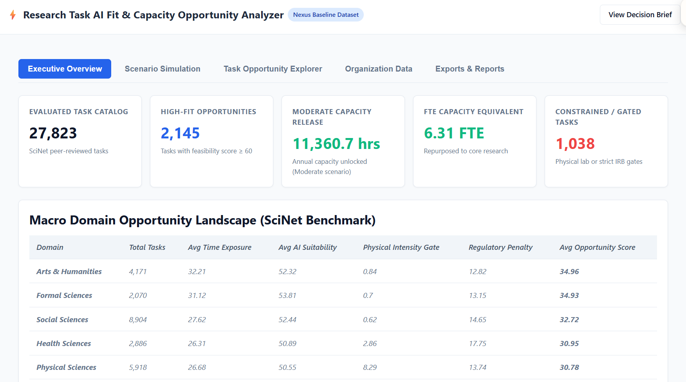
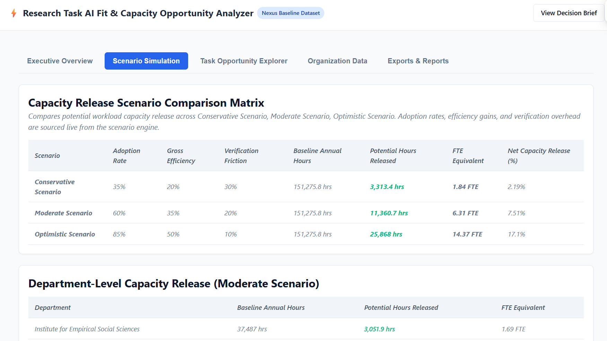
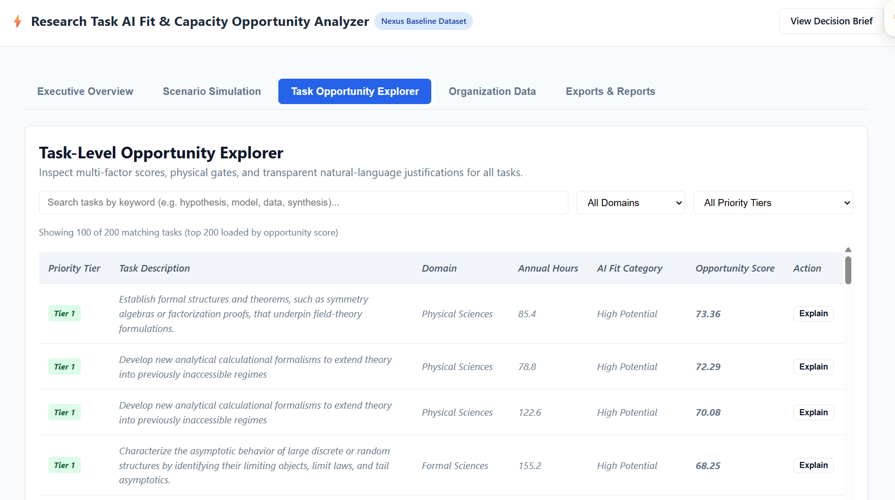
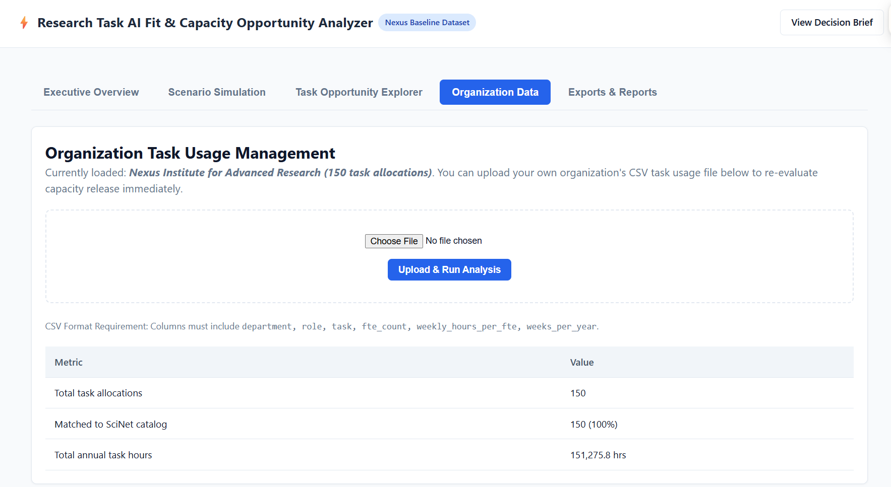
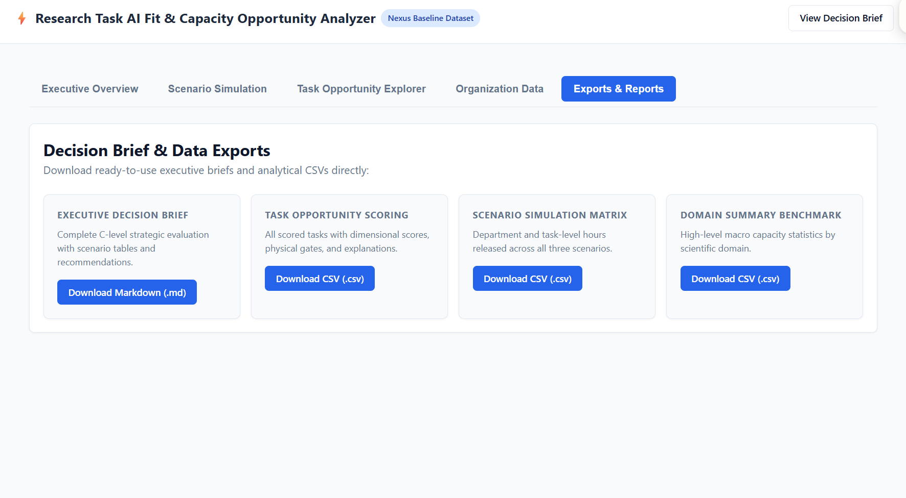

# Research Task AI Fit & Capacity Opportunity Analyzer

[](https://www.python.org/downloads/)
[](https://duckdb.org/)
[](https://github.com/astral-sh/uv)
[]()
[](LICENSE)
[](LICENSES.md)

**An end-to-end analytical decision-support application** that evaluates organizational research tasks for generative AI assistance -- enforcing physical-work constraint gates, modelling capacity-release opportunities across policy scenarios, and generating executive decision briefs from a 27,823-task peer-reviewed taxonomy.

---

> **Portfolio Project Disclosure:**<br>
> This repository is a demonstrable personal portfolio project showcasing end-to-end data engineering, analytical modeling, in-process OLAP data storage (DuckDB), scenario simulation, and a local-first interactive dashboard with zero heavy external web framework dependencies.<br>
> The organizational data for the **Nexus Institute for Advanced Research** is intentional, synthetic demonstration data. Users may upload custom organization CSV files to re-evaluate capacity release dynamically.

---

## Table of Contents
1. [Project Purpose & Problem Statement](#1-project-purpose--problem-statement)
2. [Architecture Overview](#2-architecture-overview)
3. [Technology Stack](#3-technology-stack)
4. [Dataset Foundations & Lineage](#4-dataset-foundations--lineage)
5. [Installation & Setup](#5-installation--setup)
6. [How to Run the Application](#6-how-to-run-the-application)
   - [Interactive Local Web Dashboard](#a-interactive-local-web-dashboard)
   - [Command-Line Interface (CLI)](#b-command-line-interface-cli)
7. [Screenshots](#7-screenshots)
8. [How to Provide Custom Organization Data](#8-how-to-provide-custom-organization-data)
9. [Analytical Methodology & Scoring Engine](#9-analytical-methodology--scoring-engine)
10. [Scenario Modelling & Capacity Release Simulation](#10-scenario-modelling--capacity-release-simulation)
11. [Reporting & Decision Brief Exports](#11-reporting--decision-brief-exports)
12. [Testing & Quality Verification](#12-testing--quality-verification)
13. [Skills & Technologies Demonstrated](#13-skills--technologies-demonstrated)
14. [Future Implementations](#14-future-implementations)
15. [Deployment Guide](#15-deployment-guide)
16. [Known Limitations & Governance Caveats](#16-known-limitations--governance-caveats)
17. [License & Third-Party Attribution](#17-license--third-party-attribution)

---

## 1. Project Purpose & Problem Statement

Higher education, corporate R&D divisions, and public research institutes face a dual challenge: rising administrative and analytical workloads paired with the rapid emergence of generative AI tools. Organizations often oscillate between uncritical blanket adoption and rigid rejection.

This application provides an **evidence-based decision-support framework** that:
- Deconstructs research workflows into **27,823 granular, observable tasks** grounded in the peer-reviewed SciNet taxonomy.
- Evaluates **technical AI suitability** across cognitive complexity, information media, and working modes.
- Applies strict **physical-work intensity gates** (preventing digital AI deployment on wet-bench synthesis) and **regulatory/IRB penalties**.
- Models **capacity-release opportunities** across Conservative, Moderate, and Optimistic adoption curves.
- Translates released hours into **Full-Time Equivalent (FTE) capacity equivalents** for institutional workforce planning.

> **Crucial Distinction:** Estimated capacity release represents *repurposed capacity* for core research ideation, discovery, and funding acquisition, **not** guaranteed productivity gains or workforce reduction.

---

## 2. Architecture Overview

```text
+------------------------------------------------------------------------+
|                        DATA INGESTION PIPELINE                         |
|  data/raw/scinet/ (6 CSVs)  +  data/synthetic/ (Org task allocations)  |
+-----------------------------------+------------------------------------+
                                    |
                                    v
+------------------------------------------------------------------------+
|               VALIDATION & NORMALIZATION (src/ingestion/)              |
|   * Schema & type enforcement    * Deterministic SHA-256 Task IDs      |
|   * 1,020 universal tasks saved  * Zero silent record loss             |
+-----------------------------------+------------------------------------+
                                    |
                                    v
+------------------------------------------------------------------------+
|                    EMBEDDED ANALYTICAL STORAGE (DuckDB)                |
|  database/research_task_analyzer.duckdb (27,823 tasks, org usage, views|
+-----------------------------------+------------------------------------+
                                    |
                                    v
+------------------------------------------------------------------------+
|                    ANALYTICAL & SCENARIO ENGINES                       |
|   * src/analytics/scoring_engine.py  (6-dimension multi-factor score)  |
|   * src/simulation/scenario_engine.py (Conservative/Moderate/Optimistic|
+-----------------------------------+------------------------------------+
                                    |
                                    v
+------------------------------------------------------------------------+
|                        PRESENTATION & EXPORT TIER                      |
|   * app/web_app.py (Multi-threaded HTTP Server with /health check)     |
|   * app/cli.py (Command-line pipeline runner & summary inspection)     |
|   * reports/ (Executive Decision Briefs & CSV Exports)                 |
+------------------------------------------------------------------------+
```

---

## 3. Technology Stack

- **Language:** Python 3.13.3
- **Package Management:** `uv`
- **Database:** DuckDB 2.0.1 (embedded in-process analytical SQL OLAP engine)
- **Data Engineering:** Pandas 3.1.1, NumPy 2.5.4
- **Testing:** pytest 9.2.0
- **Web Application:** Python standard library `http.server` & `socketserver.ThreadingMixIn` (zero external web framework dependencies)
- **UI Styling:** Native CSS3 responsive grid layout, accessible color palette

---

## 4. Dataset Foundations & Lineage

The application integrates three distinct data tiers:

| Tier | Data Source | Records | Role in the System |
|---|---|---:|---|
| **Primary Taxonomy** | **SciNet -- The Anatomy of Science** (`data/raw/scinet/`) | 27,823 master rows | Peer-reviewed academic task taxonomy spanning 6 scientific domains, with dimensional scores for cognitive complexity, physical deployment, and regulatory constraints. |
| **Contextual Evidence** | **Anthropic Economic Research Findings** | Calibration parameters | Aggregate macroeconomic findings on LLM task exposure, citation velocity, and verification overhead used as contextual calibration anchors. |
| **Organizational Input** | **Nexus Institute for Advanced Research** (`data/synthetic/`) | 150 allocations (151,275.8 hrs) | Intentional demonstration dataset representing faculty, postdoc, and researcher task hours across 5 departments. Replaceable via custom CSV upload. |

### Handling the 1,020 Universal Tasks
In `task_time.csv`, exactly 1,020 rows represent universal research activities that lack domain/subfield specialization. The pipeline **preserves 100% of these records** (`is_universal_unmatched = True`) and merges them into `scinet_tasks_master`, ensuring no silent data loss.

---

## 5. Installation & Setup

### Prerequisites
- Windows, macOS, or Linux
- Python 3.12 or 3.13
- `uv` package manager (`curl -LsSf https://astral.sh/uv/install.sh | sh` or `winget install astral-sh.uv`)

### Setup Instructions
1. **Clone the repository:**
   ```bash
   git clone https://github.com/srimayi-golajapu/Research-Task-AI-Fit-Capacity-Opportunity-Analyzer.git
   cd Research-Task-AI-Fit-Capacity-Opportunity-Analyzer
   ```

2. **Initialize the virtual environment with `uv`:**
   ```bash
   uv sync --system-certs
   ```

3. **Verify installed packages:**
   ```bash
   uv pip list
   ```

---

## 6. How to Run the Application

### A. Interactive Local Web Dashboard

Launch the zero-dependency, local-first interactive dashboard:

```bash
uv run python app/web_app.py --port 8501
```

Open your browser to:
**`http://localhost:8501`**

#### Dashboard Tabs:
- **Executive Overview:** Live KPI cards for total evaluated tasks, high-fit opportunities, released hours, and FTE equivalents. Includes the Macro Domain Opportunity Landscape table.
- **Scenario Simulation:** Side-by-side comparison of Conservative, Moderate, and Optimistic outcomes with department-level breakdown.
- **Task Opportunity Explorer:** Real-time keyword search, domain filtering, and priority tier filtering. The API loads the top 200 tasks by opportunity score; up to 100 are displayed per view. Click **"Explain"** on any row to open the full multi-factor scoring justification.
- **Organization Data:** Upload your own department usage CSV and re-run scenarios in an isolated session. Shows current dataset summary statistics.
- **Exports & Reports:** One-click downloads for the Markdown decision brief and all three analytical CSVs.

---

### B. Command-Line Interface (CLI)

The CLI provides full programmatic control for automation and batch execution:

```bash
# 1. Run full end-to-end pipeline (Ingestion -> Normalization -> DuckDB -> Scoring -> Simulation -> Reports)
uv run python app/cli.py run-pipeline

# 2. View executive analytical summary and scenario comparison directly in the terminal
uv run python app/cli.py summary

# 3. Ingest custom organization task usage CSV and re-run simulations
uv run python app/cli.py load-org path/to/my_organization_tasks.csv

# 4. Regenerate all Markdown decision briefs and CSV exports
uv run python app/cli.py export

# 5. Start the web dashboard via CLI
uv run python app/cli.py serve --port 8501
```

---

## 7. Screenshots

The following screenshots were captured from the running application using the Nexus Institute for Advanced Research demonstration dataset.

### Executive Overview & KPI Cards

*Five live KPI cards (27,823 evaluated tasks, 2,145 high-fit opportunities, 11,360.7 hrs Moderate capacity release, 6.31 FTE equivalent, 1,038 constrained tasks) and the Macro Domain Opportunity Landscape table showing average scores across six scientific domains.*

### Scenario Simulation

*Capacity Release Scenario Comparison Matrix: Conservative (3,313.4 hrs, 1.84 FTE, 2.19%), Moderate (11,360.7 hrs, 6.31 FTE, 7.51%), and Optimistic (25,868 hrs, 14.37 FTE, 17.1%) outcomes on 151,275.8 baseline hours. Department-level breakdown shown below the matrix.*

### Task Opportunity Explorer

*Searchable and filterable catalog. The API loads the top 200 tasks by opportunity score; up to 100 are shown per view (as confirmed by the "Showing 100 of 200 matching tasks" label). Each row shows Priority Tier badge, task description, domain, annual hours, AI fit category, and opportunity score. The "Explain" button opens the full multi-factor scoring modal.*

### Organization Data & CSV Upload

*Organization Task Usage Management tab showing the currently loaded Nexus Institute for Advanced Research dataset (150 task allocations, 100% matched to SciNet, 151,275.8 annual task hours) with the CSV upload form for custom organization data.*

### Exports & Reports

*Decision Brief & Data Exports tab with four download cards: Executive Decision Brief (Markdown), Task Opportunity Scoring (CSV), Scenario Simulation Matrix (CSV), and Domain Summary Benchmark (CSV).*

---

## 8. How to Provide Custom Organization Data

You can evaluate custom departmental task usage instead of the default demonstration dataset.

### Expected CSV Schema
Prepare a CSV file with the following column headers:

```csv
department,role,task,fte_count,weekly_hours_per_fte,weeks_per_year,current_ai_usage
Department of Biosciences,Senior Researcher,Extract and sequence microbial DNA from soil samples,4,6.5,48,Minimal (<10%)
Institute for Social Sciences,Data Analyst,Fit Bayesian hierarchical model to survey data,3,8.0,46,Occasional (10-30%)
```

### Loading your Data:
1. **Via the Web Dashboard:** Navigate to the **"Organization Data"** tab, select your file, and click **"Upload & Run Analysis"**.
2. **Via the CLI:**
   ```bash
   uv run python app/cli.py load-org my_org_data.csv
   ```

The pipeline matches tasks against `scinet_tasks_master` using composite hierarchy keys and falls back gracefully when subfields are omitted. Failed uploads automatically roll back without corrupting the baseline database state.

---

## 9. Analytical Methodology & Scoring Engine

Every task is evaluated across six transparent analytical dimensions (0-100 scale):

1. **Time Exposure Score (S_time):**

   `S_time = min(100, log10(max(1, hours)) / log10(500) * 100)`

   Reflects the annual workload footprint. Tasks taking >= 500 hours/year score 100.

2. **AI Suitability Score (S_ai):**

   `S_ai = 0.40 * Info_Medium + 0.30 * Cognitive_Fit + 0.20 * Mode_Alignment + 0.10 * Verification_Density`

   Synthesizes digital information density, cognitive complexity alignment, and qualitative/quantitative modes.

3. **Physical-Work Intensity Gate (P_phys):**

   `P_phys = 0.70 * Materials_Medium + 0.30 * (Physical_Deployment / 5.0 * 100)`

   Tasks requiring physical laboratory materials or in-situ deployment are strictly gated.

4. **Regulatory & Operational Penalty (R_reg):**

   `R_reg = 0.80 * (Regulatory_Restriction / 5.0 * 100) + (Is_Core * 15.0)`

   Penalizes tasks bound by ethics protocols, human subject oversight, or legal sign-offs.

5. **Feasibility Score (S_feas):**

   `S_feas = S_ai * (1 - P_phys / 100) * (1 - 0.70 * R_reg / 100)`

6. **Composite Capacity Opportunity Score (S_opp):**

   `S_opp = (0.50 * S_time + 0.50 * S_feas) * (1 - 0.40 * S_adopt / 100)`

### Priority Tiers:
- **Tier 1: Immediate Opportunity (S_opp >= 65):** High workload + high feasibility + minimal physical gating.
- **Tier 2: Targeted Augmentation (45 <= S_opp < 65):** Meaningful time release with moderate human-in-the-loop review.
- **Tier 3: Exploratory / Minor (25 <= S_opp < 45).**
- **Tier 4: Deprioritized / Blocked (S_opp < 25).**

---

## 10. Scenario Modelling & Capacity Release Simulation

Capacity release is simulated across three governance stances:

```
Delta_H_i = H_i * Adoption_Rate * [Gross_Efficiency * (1 - Verification_Friction)] * (S_feas_i / 100)
FTE_Equivalent = Delta_H_i / 1800 hrs/year
```

| Scenario | Adoption Rate | Gross Speedup | Verification Friction | Net Efficiency Factor |
|---|---:|---:|---:|---:|
| **Conservative** | 35% | 20% | 30% | 14.0% |
| **Moderate** | 60% | 35% | 20% | 28.0% |
| **Optimistic** | 85% | 50% | 10% | 45.0% |

### Baseline Results on Nexus Institute Demonstration Data (151,275.8 Baseline Hours):
- **Conservative:** 3,313.4 hours released (1.84 FTE equivalent, 2.19% net capacity gain).
- **Moderate:** 11,360.7 hours released (6.31 FTE equivalent, 7.51% net capacity gain).
- **Optimistic:** 25,868.0 hours released (14.37 FTE equivalent, 17.10% net capacity gain).

---

## 11. Reporting & Decision Brief Exports

Running `app/cli.py export` or `export_all_reports()` automatically generates four deliverables in [`reports/`](reports/):

1. **`reports/executive_decision_brief.md`**: Executive C-level decision brief summarizing strategic findings, departmental breakdowns, sensitivity comparisons, and governance recommendations.
2. **`reports/task_opportunity_scoring.csv`**: Task-level scores across all 27,823 tasks with dimensional metrics and explanations.
3. **`reports/scenario_simulation_matrix.csv`**: Granular simulation outputs across Conservative, Moderate, and Optimistic scenarios.
4. **`reports/domain_opportunity_summary.csv`**: Aggregated macro metrics by scientific domain.

---

## 12. Testing & Quality Verification

The test suite covers unit tests, schema validation, normalization preservation, database integrity, scoring logic, scenario calculations, HTTP routes, multipart CSV uploads, session isolation, and CLI commands.

Execute tests using pytest:

```bash
uv run pytest -v tests
```

Execute the comprehensive 10-suite end-to-end functional QA runner:

```bash
uv run python tests/functional_qa_runner.py
```

### Test Suite Summary:
```text
tests/test_analytics.py              3 passed
tests/test_app_cli.py                2 passed
tests/test_database.py               3 passed
tests/test_ingestion.py              4 passed
tests/test_normalization.py          2 passed
tests/test_reporting.py              2 passed
tests/test_scenarios.py              2 passed
tests/test_validation.py             3 passed
tests/test_web_app.py               27 passed
================================= 48 passed ==================================

Functional QA runner: 10/10 suites passed (100% success)
```

Execution time varies by machine. The functional QA runner exercises live database queries, scenario engine calculations, upload safety, and report content -- not just unit logic.

---

## 13. Skills & Technologies Demonstrated

This project was built without a web framework or BI platform -- no Streamlit, Flask, FastAPI, Dash, or BI tool handles the dashboard, routing, or data layer. Every layer is hand-crafted and verifiable in the source code.

### Programming & Software Engineering
- **Python 3.13** -- Type hints, `pathlib`, `io.BytesIO`, `hashlib`, `email.message` for MIME multipart parsing (replacing the Python 3.13-removed `cgi` module), `uuid`, `threading`, `socketserver`
- **Object-Oriented Design** -- `SessionState`, `SessionManager`, `ScoringEngine`, `ScenarioEngine` with clear separation of concerns
- **Standard Library HTTP Server** -- `http.server.BaseHTTPRequestHandler` + `socketserver.ThreadingMixIn` for concurrent multi-visitor handling with zero external web framework dependencies
- **Multipart Form Parsing** -- Custom `email`-module-based MIME parser for `multipart/form-data` CSV uploads
- **Cookie-Based Session Management** -- `HttpOnly; SameSite=Lax` session cookies with 30-minute TTL (`SESSION_TTL_SECONDS = 1800`) and LRU eviction at 50 concurrent sessions (`MAX_SESSIONS = 50`)

### Database & Data Engineering
- **DuckDB** -- Embedded in-process analytical OLAP SQL engine; schema design, DDL, DML, aggregate views, deterministic SHA-256 task ID generation in SQL
- **Pandas** -- Multi-source DataFrame ingestion, schema normalization, outer joins, type coercion
- **SQL** -- GROUP BY aggregations, LEFT JOIN resolution, `CREATE VIEW` materialization, `ATTACH` / `DETACH` for read-only baseline access
- **Data Pipeline Design** -- Seven-stage ETL pipeline: raw CSV ingest -> validation -> normalization -> DuckDB load -> scoring -> simulation -> report export
- **Per-Visitor Session Isolation** -- Each CSV-uploading visitor receives an isolated in-memory DuckDB (`:memory:`) with the baseline catalog attached read-only; uploads and simulations execute in RAM and are not persisted to disk

### Analytical Modeling
- **Multi-Factor Scoring Engine** -- 6-dimensional weighted composite formula with physical-work intensity gate and regulatory penalty functions
- **Scenario Simulation** -- Parameterized Conservative / Moderate / Optimistic capacity-release model with configurable adoption rate, gross efficiency, and verification friction
- **FTE Conversion** -- Annualized hours-to-headcount translation using 1,800 hrs/year baseline
- **Priority Tier Classification** -- Threshold-based Tier 1-4 decision rule applied across 27,823 tasks

### Web Development & UI
- **Single-Page Dashboard** -- HTML/CSS/JavaScript dashboard embedded in `app/web_app.py`; no bundler, no build step, no external JavaScript libraries
- **CSS3 Grid Layout** -- Responsive KPI card grid, tabbed navigation, scrollable task explorer table
- **Vanilla JavaScript** -- Fetch API for async data loading, real-time keyword search and filter, modal dialogs, tab switching, file upload UX

### Security & Reliability Engineering
- **Path Traversal Prevention** -- `ALLOWED_REPORT_FILES` allowlist; file name validated against the set before any `open()` call; names containing `..`, `/`, or `\` rejected with HTTP 400
- **Input Validation** -- Required column check, type coercion guards, 2 MB upload ceiling (`MAX_UPLOAD_BYTES`), HTTP 413 on oversized uploads, empty-file detection
- **Error Message Sanitization** -- `sanitize_error_message()` strips Windows drive paths and Linux root paths (e.g. `/opt/render/...`) from error strings before returning them to the client, truncated to 200 characters
- **Upload Rollback** -- Failed CSV ingestion raises before modifying the session database, leaving state unchanged

### Testing & Quality Assurance
- **pytest** -- 48 unit and integration tests across 9 modules covering analytics, database, ingestion, normalization, scenarios, reporting, CLI, and HTTP routes
- **Functional QA Runner** -- 10-suite end-to-end QA script (`tests/functional_qa_runner.py`) verifying live database correctness, scoring engine fidelity, scenario arithmetic, upload safety, and report content
- **HTTP Route Testing** -- Multipart POST upload simulation, path traversal blocking, 404/400/413 error responses, health check endpoint, session isolation, and upload size limit

### DevOps & Deployment
- **uv** -- Deterministic dependency management with `uv.lock`; reproducible installs across OS platforms
- **Git / GitHub** -- Clean `.gitignore`, attribution documentation, private repository
- **Render Deployment Config** -- `render.yaml` blueprint for zero-configuration free-tier cloud deployment
- **Health Endpoints** -- `/health` and `/api/health` JSON endpoints for container health checks

---

## 14. Future Implementations

The following enhancements are **planned** and not yet implemented.

### Public Deployment
- **Render Free Tier Launch:** Deploy the application to a publicly accessible URL so portfolio reviewers, collaborators, and hiring managers can interact with it without cloning the repository. The source repository will remain private; only the hosted web service will be public.
- **Custom Domain:** Configure a memorable subdomain once the Render service is live.

### Dashboard & UX Improvements
- **Persistent URL State:** Encode active tab, search query, and domain filter into the browser URL hash so users can share deep links to specific views.
- **Sortable Columns:** Make all Task Opportunity Explorer table columns sortable client-side by clicking headers.
- **Export Filtered View:** Allow users to download only the currently visible (filtered/searched) rows of the task explorer as a CSV.
- **Dark Mode Toggle:** Add a light/dark theme switcher persisted in `localStorage`.
- **Pagination Controls:** Replace the current 100-row display cap (100 shown from 200 loaded) with configurable pagination (25 / 50 / 100 / All rows).

### Expanded Analytics
- **Sensitivity Analysis Panel:** Interactive sliders to adjust adoption rate, gross speedup, and verification friction parameters and observe real-time scenario output changes -- without committing to a fixed scenario preset.
- **Benchmarking Comparisons:** Upload two organization CSVs and display a side-by-side departmental comparison view.
- **Historical Trend Simulation:** Model year-over-year capacity release growth as AI adoption matures from Conservative toward Optimistic over a 3-5 year horizon.
- **Domain Heat Map:** Visual heatmap of opportunity scores across SciNet scientific domains and subfields.

### Data & Methodology Enhancements
- **Scoring Parameter Versioning:** Maintain a versioned configuration file for scoring weights so parameter updates are traceable and comparable across runs.
- **Confidence Interval Reporting:** Surface uncertainty ranges on FTE release estimates based on parameter sensitivity bounds.

---

## 15. Deployment Guide

The application is architected for zero-cost, cloud-ready deployment on **Render's Free Web Service** tier or any standard Linux container. Deployment has not yet been performed; the steps below are the planned procedure.

### Planned Architecture on Render Free Tier

| Specification | Free Tier Detail | Architectural Handling |
| :--- | :--- | :--- |
| **Compute** | 0.1 CPU, 512 MB RAM | Zero-dependency standard library HTTP server + in-process DuckDB |
| **Filesystem** | Ephemeral (resets on restart/spin-down) | Committed baseline database (`research_task_analyzer.duckdb`) is read-only at runtime; custom uploads execute in RAM |
| **Visitor Data** | Multi-visitor public access | Ephemeral in-memory DuckDB sessions per visitor; uploads and simulations are isolated via cookies and never written to disk |
| **Concurrency** | Shared compute | Threaded HTTP server with per-session locks; baseline database opened read-only |
| **Idle Behavior** | Spin-down after 15 min of inactivity; approximately 1 min to spin back up | Application boots directly into DuckDB-ready state; no warm-up data loading required |

---

### Step-by-Step Deployment on Render

#### Option A: One-Click Blueprint Deployment (Recommended)
This repository includes a [`render.yaml`](render.yaml) specification:
1. Authorize Render to access this GitHub repository through the [Render GitHub integration](https://render.com/docs/github). The repository can remain **private** -- Render's GitHub App does not require public visibility.
2. Go to the [Render Dashboard](https://dashboard.render.com/) and select **New > Blueprint**.
3. Connect your GitHub repository. Render will automatically parse `render.yaml` and configure the service.
4. Click **Apply**.

#### Option B: Manual Web Service Setup
1. In the [Render Dashboard](https://dashboard.render.com/), click **New > Web Service**.
2. Connect your repository via the Render GitHub App (private repositories are supported).
3. Configure settings:
   - **Name:** `research-task-ai-analyzer`
   - **Runtime:** `Python`
   - **Branch:** `main`
   - **Region:** `Oregon (US West)` or `Frankfurt (EU)`
   - **Plan:** `Free`
   - **Build Command:**
     ```bash
     pip install uv && uv sync --frozen
     ```
   - **Start Command:**
     ```bash
     uv run python app/web_app.py --port $PORT
     ```
   - **Health Check Path:** `/health`
4. Add Environment Variable:
   - `PYTHON_VERSION`: `3.13.3`
5. Click **Create Web Service**.

---

### Visitor Isolation & Ephemeral Data Handling

- **Public Demonstration Baseline:** All visitors view the pre-computed **Nexus Institute for Advanced Research** demonstration dataset from the read-only committed DuckDB database.
- **Custom CSV Uploads:** When a visitor uploads their organization's CSV, an ephemeral in-memory DuckDB database is spawned for that visitor's session, tracked via an `HttpOnly` session cookie.
- **Ephemeral Visitor Data:** Custom uploads and scenario simulations execute entirely in RAM. The baseline database file and static reports on disk are not modified at runtime.
- **Session Isolation:** Each visitor's upload is isolated to their own in-memory session. Other visitors browsing simultaneously see only the baseline dataset (or their own session data).
- **Session Reset:** Visitors can return to the baseline dataset by clicking **Reset to Baseline** or visiting `/api/reset`.
- **Session Expiry:** In-memory sessions expire after 30 minutes of inactivity (`SESSION_TTL_SECONDS = 1800`) and are capped at 50 concurrent sessions (`MAX_SESSIONS = 50`) with LRU eviction.

---

## 16. Known Limitations & Governance Caveats

1. **No Autonomous Laboratory Execution:** Generative AI models operate exclusively in digital and informational domains. Tasks requiring wet-lab chemical synthesis, surgical trials, or physical specimen collection cannot be executed by digital models alone.
2. **Mandatory Human Accountability:** Scientific peer review and regulatory bodies require authoritative human accountability. AI augmentation cannot replace the principal investigator's liability.
3. **Verification Friction Reality:** Time savings from AI draft generation are partially offset by the necessary cognitive labor of prompt refinement, factual verification, and hallucination auditing.
4. **Dynamic Model Capabilities:** Frontier model benchmarks evolve continuously. The scoring parameters reflect current frontier LLM capabilities and can be updated in `src/analytics/scoring_engine.py`.

---

## 17. License & Third-Party Attribution

- **Application Code:** MIT License (see [LICENSE](LICENSE)).
- **SciNet Datasets:** Creative Commons Attribution 4.0 International (CC BY 4.0) by Lukas Althoff et al. (see [LICENSES.md](LICENSES.md)).
